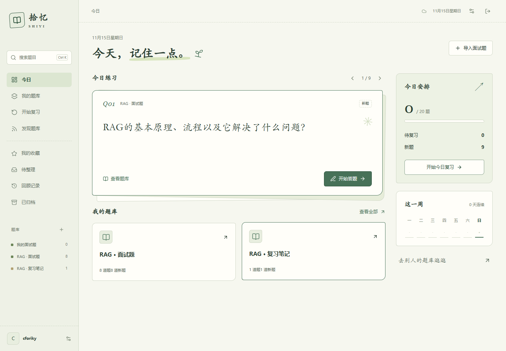

# 首版验证记录

日期：2026-11-14。环境：Windows，Node.js 24.22.2，项目锁定的依赖版本。

## 已通过

- `npm run typecheck`。
- `npm test`：16 项通过，涵盖 Markdown / Q&A / 编号导入、代码与列表保留、FSRS-7 调度与序列化、密钥加密及用户绑定、账号隔离、导入去重、发布与订阅、笔记版本检查、复习幂等、统计汇总和导出过滤，以及完整原文导入、校验过期提示、8 位注册密码边界和 Obsidian / 数学公式显示。
- `npm run test:e2e`：2 项通过，分别使用桌面 Chrome 1440×1000 视口与 390×844 触摸视口。实际操作注册、载入示例、粘贴自动入库、划选引用、无 Key 提示、私人笔记保存、模拟其他页面修改后的冲突恢复、Tiptap 编辑与表格保留、展开答案及复习评分；检查无页面异常和横向溢出。
- `npm run build`：生产构建通过。
- `package.json` 与锁文件依赖、开发依赖一致；本地密钥、数据库、缓存、构建与测试数据均被 Git 忽略。
- 关闭开发与测试服务后，用新进程重新打开落盘测试数据库，确认题目、个人笔记和复习记录仍存在，随后关闭数据库连接。

浏览器流程使用独立测试数据库，未写入日常使用的数据目录。受当前 Windows 沙箱进程清理限制，本次从单独的测试服务运行浏览器测试，并通过 `PLAYWRIGHT_EXTERNAL_SERVER=1` 复用该服务；全部测试完成后手动关闭。

## 原题库与认领账号

- 已通过正常注册流程创建本地认领账号，并验证密码登录及会话；没有将密码写入项目文件或命令行参数。
- 原始目录的 10 份 Markdown 保留完整字节副本，8 道主问题与 1 份笔记按整篇导入，28 道追问不拆分；索引保留原文记录。数据库的答案及来源文本与清单 SHA-256 一致。
- 题库默认私有。内容校验记录独立存储，最终 10 条说明：3 处概念问题、5 处适用条件、2 处术语笔误。第 3 题在工作期间发生外部编辑，核对新增段落后同步到本次快照，旧快照在本地备份中留存；没有写回源目录。
- 使用认领账号额外进行了两种视口的只读检查：登录、私有题库、公式无解析错误、追问 callout、关联题目跳转、校验面板和表格均正常；无页面异常和横向溢出。未评分或保存笔记，仍保留未学习状态。
- 阅读页截图：`imported-rag-desktop.png`、`imported-rag-mobile.png`。只读检查脚本为 `scripts/verify-library-ui.ts`，凭证仅通过标准输入传入。

## 验证边界

- AI 使用模拟的 DeepSeek SSE 流验证，没有使用真实 Key，也没有产生模型费用；真实模型调用需要用户配置后验证。
- 数据库路径使用内存/文件形式的 PGlite。标准 PostgreSQL、Docker 和公网 HTTPS 配置已提供，但本机没有 Docker / PostgreSQL 服务，尚未在目标服务器实测。
- 手机检查为 Chrome 触摸视口模拟，没有在真实 iPhone Safari 上实测。
- 第一版在线使用，没有离线同步、完整备份恢复、邮件验证和密码找回服务。

## 2026-11-15 界面与学习流程更新

- 手绘简约与扁平卡片界面，保留绿色配色；首页手动切换练习卡，阅读页拆为正文、追问、笔记、记忆，校验说明收进菜单。
- `npm test`：22 项通过；新增嵌套段落切分、完整 28 道追问提取、私有作答保存、重试幂等及账号隔离检查。
- `npm run test:e2e`：电脑及手机视口 2 项通过；覆盖单段遮挡、对照、草稿恢复、追问切换与答案隐藏、整题输入、作答草稿导航恢复、评分及作答记录保存。既有笔记冲突处理、AI 划选和表格编辑流程也通过。
- `npm run typecheck`、`npm run build` 通过。新增迁移只为复习记录增加可空的作答字段，不修改题库正文。
- 使用本地认领账号再次只读检查两种视口：9 张资料卡、公式、关联链接、独立追问、校验菜单、段落默写和答题入口正常，无页面异常及横向溢出；检查前后个人笔记及复习状态一致。
- 原文清单哈希继续保留；当前浏览器中的段落、追问及未提交作答草稿按账号和题目版本隔离，提交的整题作答才进入账号的复习历史。

## 2026-11-17 OpenAI 兼容接口

- 连接表单统一为 OpenAI 兼容协议，支持 OpenAI、DeepSeek、自定义预设，以及可编辑的 Base URL、API Key、模型名。测试读取未保存表单，不覆盖已有连接；模型切换可保留相同接口的 Key。
- 新迁移为旧配置补充原 DeepSeek 地址，保留已有加密 Key 与模型。聊天、AI 导入、连接测试共用适配器；新增 SSE 末行及结束标记处理。
- `npm test`：32 项通过，覆盖自定义路径、接口切换与密钥绑定、JSON/流式调用、AI 导入、模型参数、迁移保留、DNS/IP 检查、重定向、响应大小限制，以及原生 Node fetch 与网络适配器兼容性。
- `npm run test:e2e`：4 项通过，分别在电脑和手机视口验证 AI 预设、手动配置、测试不保存、同地址保留密钥、切换地址重新填写及完整学习流程；`npm run build` 通过。
- 对 OpenAI、DeepSeek 的模型列表接口做无密钥 HTTPS 检查，均到达服务并返回预期的 401；没有发起真实模型生成或使用用户 Key。
- 本机 DNS 使用代理虚拟网段。官方来源及管理员配置的来源可使用该代理网段，其他自定义服务仍要求可验证的公网地址。相关正反例均有测试。

## 当前界面预览

桌面：

手机视口：

[阅读](notebook-reader-desktop.png) · [段落默写](notebook-paragraph-desktop.png) · [整题答题](notebook-answer-desktop.png) · [追问](notebook-followups-desktop.png)
