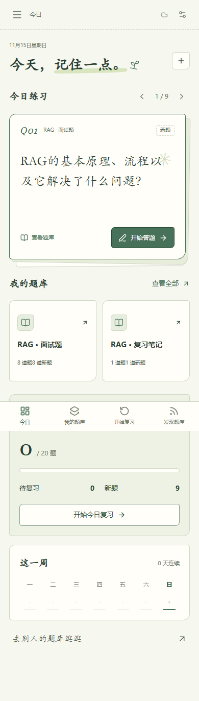

# 首版验证记录

日期：2026-11-14。环境：Windows，Node.js 24.22.2，项目锁定的依赖版本。

## 已通过

- `npm run typecheck`。
- `npm test`：16 项通过，涵盖 Markdown / Q&A / 编号导入、代码与列表保留、FSRS-7 调度与序列化、密钥加密及用户绑定、账号隔离、导入去重、发布与订阅、笔记版本检查、复习幂等、统计汇总和导出过滤，以及完整原文导入、校验过期提示、8 位注册密码边界和 Obsidian / 数学公式显示。
- `npm run test:e2e`：2 项通过，分别使用桌面 Chrome 1440×1000 视口与 390×844 触摸视口。实际操作注册、载入示例、粘贴自动入库、划选引用、无 Key 提示、私人笔记保存、模拟其他页面修改后的冲突恢复、Tiptap 编辑与表格保留、展开答案及复习评分；检查无页面异常和横向溢出。
- `npm run build`：生产构建通过。
- `package.json` 与锁文件依赖、开发依赖一致；本地密钥、数据库、缓存、构建与测试数据均被 Git 忽略。
- 关闭开发与测试服务后，用新进程重新打开落盘测试数据库，确认题目、个人笔记和复习记录仍存在，随后关闭数据库连接。

浏览器流程使用独立测试数据库，未写入日常使用的数据目录。受当前 Windows 沙箱进程清理限制，本次从单独的测试服务运行浏览器测试，并通过 `PLAYWRIGHT_EXTERNAL_SERVER=1` 复用该服务；全部测试完成后手动关闭。

## 原题库与认领账号

- 已通过正常注册流程创建本地认领账号，并验证密码登录及会话；没有将密码写入项目文件或命令行参数。
- 原始目录的 10 份 Markdown 保留完整字节副本，8 道主问题与 1 份笔记按整篇导入，28 道追问不拆分；索引保留原文记录。数据库的答案及来源文本与清单 SHA-256 一致。
- 题库默认私有。内容校验记录独立存储，最终 10 条说明：3 处概念问题、5 处适用条件、2 处术语笔误。第 3 题在工作期间发生外部编辑，核对新增段落后同步到本次快照，旧快照在本地备份中留存；没有写回源目录。
- 使用认领账号额外进行了两种视口的只读检查：登录、私有题库、公式无解析错误、追问 callout、关联题目跳转、校验面板和表格均正常；无页面异常和横向溢出。未评分或保存笔记，仍保留未学习状态。
- 阅读页截图：`imported-rag-desktop.png`、`imported-rag-mobile.png`。只读检查脚本为 `scripts/verify-library-ui.ts`，凭证仅通过标准输入传入。

## 验证边界

- AI 使用模拟的 DeepSeek SSE 流验证，没有使用真实 Key，也没有产生模型费用；真实模型调用需要用户配置后验证。
- 数据库路径使用内存/文件形式的 PGlite。标准 PostgreSQL、Docker 和公网 HTTPS 配置已提供，但本机没有 Docker / PostgreSQL 服务，尚未在目标服务器实测。
- 手机检查为 Chrome 触摸视口模拟，没有在真实 iPhone Safari 上实测。
- 第一版在线使用，没有离线同步、完整备份恢复、邮件验证和密码找回服务。

## 2026-11-15 界面与学习流程更新

- 手绘简约与扁平卡片界面，保留绿色配色；首页手动切换练习卡，阅读页拆为正文、追问、笔记、记忆，校验说明收进菜单。
- `npm test`：22 项通过；新增嵌套段落切分、完整 28 道追问提取、私有作答保存、重试幂等及账号隔离检查。
- `npm run test:e2e`：电脑及手机视口 2 项通过；覆盖单段遮挡、对照、草稿恢复、追问切换与答案隐藏、整题输入、作答草稿导航恢复、评分及作答记录保存。既有笔记冲突处理、AI 划选和表格编辑流程也通过。
- `npm run typecheck`、`npm run build` 通过。新增迁移只为复习记录增加可空的作答字段，不修改题库正文。
- 使用本地认领账号再次只读检查两种视口：9 张资料卡、公式、关联链接、独立追问、校验菜单、段落默写和答题入口正常，无页面异常及横向溢出；检查前后个人笔记及复习状态一致。
- 原文清单哈希继续保留；当前浏览器中的段落、追问及未提交作答草稿按账号和题目版本隔离，提交的整题作答才进入账号的复习历史。

## 2026-11-17 OpenAI 兼容接口

- 连接表单统一为 OpenAI 兼容协议，支持 OpenAI、DeepSeek、自定义预设，以及可编辑的 Base URL、API Key、模型名。测试读取未保存表单，不覆盖已有连接；模型切换可保留相同接口的 Key。
- 新迁移为旧配置补充原 DeepSeek 地址，保留已有加密 Key 与模型。聊天、AI 导入、连接测试共用适配器；新增 SSE 末行及结束标记处理。
- `npm test`：32 项通过，覆盖自定义路径、接口切换与密钥绑定、JSON/流式调用、AI 导入、模型参数、迁移保留、DNS/IP 检查、重定向、响应大小限制，以及原生 Node fetch 与网络适配器兼容性。
- `npm run test:e2e`：4 项通过，分别在电脑和手机视口验证 AI 预设、手动配置、测试不保存、同地址保留密钥、切换地址重新填写及完整学习流程；`npm run build` 通过。
- 对 OpenAI、DeepSeek 的模型列表接口做无密钥 HTTPS 检查，均到达服务并返回预期的 401；没有发起真实模型生成或使用用户 Key。
- 本机 DNS 使用代理虚拟网段。官方来源及管理员配置的来源可使用该代理网段，其他自定义服务仍要求可验证的公网地址。相关正反例均有测试。

## 2026-11-17 用户隔离、部署与清理

- 41 项核心及后端测试通过。新增双账号攻击用例覆盖私有题库/题目、导入批次、发布与订阅、笔记、收藏、作答、对话及导出；两个账号同时配置不同接口、模型和密钥，并行聊天/AI 导入均使用各自配置，删除一方密钥不影响另一方。
- 生产构建上的 6 项浏览器测试通过（电脑/手机各 3 项），包括换号时延迟返回的旧请求、复习队列重置、未保存密钥及草稿隔离，以及原有导入、段落默写、追问、编辑和复习流程。测试请求使用独立 IP 配额，认证限流保持开启。
- 页面按账号重新挂载，退出时取消旧请求；客户端请求附带期望账号，服务端始终以会话为准，身份不一致返回 409。移除不可访问题目的旧复习卡回退；手机退出入口恢复可用。
- 所有业务和认证响应统一 `private, no-store`，包含错误及流式响应，并保留 Cookie/Origin 的 Vary。生产 HTTP 实测：匿名题库 401、陌生来源写入 403、会话响应均带禁止缓存头；健康检查 200 且不返回用户信息。
- 更新确认接口先核对本人的订阅，短 API Key 不显示完整密钥。密钥仍按用户 ID 绑定加密，导出不含密钥和其他用户私有数据。登录、业务写接口和开发资源共用明确的来源列表，保留局域网配置能力。
- `npm run build`、类型检查、Prettier、`git diff --check`、Drizzle 迁移文件检查通过；`npm ci --dry-run` 验证锁文件一致。只调整 KaTeX/esbuild 相关间接依赖，当前 `npm audit` 为 0；数学公式及不可信 Markdown 渲染检查通过。对应上游说明：[KaTeX](https://github.com/KaTeX/KaTeX/security/advisories/GHSA-238p-pmpm-9mq7)、[esbuild](https://github.com/evanw/esbuild/security/advisories/GHSA-67mh-4wv8-2f99)。
- 生产启动在监听前检查配置，错误密钥实测立即退出；本地生产模式的迁移、启动和健康检查通过。容器使用启动前 PostgreSQL 迁移、同连接迁移锁、独立数据库连接字段、非 root 用户和健康检查；提供 HTTPS 代理及备份说明。
- Windows 独立运行包复制出现过权限错误；常规本地构建保持标准输出，standalone 仅在 Linux 容器构建中启用，容器构建另有依赖文件完整性检查。**Docker / 标准 PostgreSQL / Nginx 未在本机实测**，需在目标服务器验收。开放注册前仍需补齐邮件找回；现有本地账号库上云需要另行迁移。
- 移除 188 个未使用样式选择器及无用导入，开启未使用代码检查，收紧 TypeScript 扫描目录。提供有路径边界检查的 `npm run clean`，只清理构建、测试库、测试结果与缓存。
- 原文清单的 10 份 SHA-256 全部一致。日常 `.data/postgres`、备份、导入记录、原文和 `.env.local` 保留；本轮检查未使用认领账号密码，也未调用真实付费模型。

## 2026-11-17 仅题目导入与 AI 参考答案

- 新增“题目与答案 / 只有题目”导入选择。只有题目时每个非空行单独保存，识别数字/中文编号、列表和 Markdown 标题，不把下一行题目当作答案；标题过长明确拒绝，重复导入或同题库已有同名答案时跳过。
- 新增迁移 `0004_question_only_import.sql` 记录导入类型，旧记录默认 `qa`。迁移测试以数据库内 UTF-8 字节校验原文，包含 BOM、CRLF 与首尾空白均未被迁移更改；没有改动已有题目答案。
- 待整理列表和空白学习卡均可生成 AI 参考答案。生成接口只接受本人拥有、未归档且没有答案的题目，使用本人的模型及密钥。生成只返回草稿，保存继续走版本校验；无权限、过期版本和已有答案均在调用模型前拒绝。
- 草稿支持编辑、补充要求、重新生成、停止、关闭后恢复。保存后自动退出待整理；首页和题库正确显示待补答案，空答案不计入可复习新题。长题目及手机窗口内的保存按钮已验证可见。
- `npm test`：46 项全部通过，覆盖新增解析、迁移、同名题目去重、双用户模型配置、生成不落库、明确保存、并发修改冲突及服务错误释放并发额度。
- `npm run test:e2e`：生产构建上 10 项全部通过，电脑/手机各 5 项；覆盖原有流程和新增导入、无 Key 配置引导、草稿恢复不重复生成、自定义要求、取消后迟到响应、保存冲突及长题目布局。
- 生产构建、类型检查及 Drizzle 迁移文件检查通过。受限 Windows 文件系统构建曾出现临时目录创建错误，验证构建在 `UV_THREADPOOL_SIZE=1` 下通过；没有修改全局 Node 环境或框架依赖。
- AI 测试使用模拟响应，没有调用用户的真实模型服务。日常账号库与原始资料保持原位，构建、测试结果及测试数据库在验证后清理；仅保留精选界面截图供查看。

## 2026-11-17 卡片交互、题库管理与导入确认

该节的题库回收站行为已由下文“题目独立归属与 30 天回收站”替代。

- 首页练习与追问使用卡片两侧的半透明圆形按钮，电脑、手机均保留操作空间；菜单点击外部、按 Esc 或选择操作后收起。
- 题库页先展示题库卡片，题目、归档和回收站分别进入；从题目返回保留原来的搜索和筛选，收藏、待整理和历史也返回原入口。题库删除前确认，删除后可在回收站恢复，笔记和学习记录保留。作者删除后停止公开发现及发布，已有订阅者保留最后发布版。
- 默认每日目标 5 道、每天最多新学 3 道，可在设置中分别调整（新题上限可设 0）。当天同一道题反复评分只计一道，事件历史仍完整保留；到期题与单题自由练习不受目标硬限制。迁移 0005 将原值 20 调整为 5，其他自定目标保留。
- 导入改为“解析并预览 → 编辑、勾选、合并或补题 → 确认入库”。可选择自动切分、AI 解析，题目与答案资料还可整篇保留；改动原文或解析方式后必须重新解析。关闭窗口保留本账号的本地预览草稿，不自动付费调用或保存题目。
- 支持粘贴及读取 UTF-8 的 .md / .txt 文件（400 KB、10 万字符以内）；AI 每批最多 25000 字符。自动切分按原文位置提取答案，AI 只返回边界行号，服务端验证后提取原文，不使用模型重写答案。超长题目不截断，先在预览中修改。完整原文、文件名和 SHA-256 独立保存，包含 BOM、CRLF、首尾空白；所有者可查看、下载及导出，发布订阅不暴露整批原文。
- 预览本身不写题库；确认时锁定本人有效题库和批次，提交哈希保证重试幂等，同题库去重。无效/代码块内/越界的 AI 边界、JSON 错误及模型截断不会产生题目。测试覆盖跨账号猜测批次、题库删除及恢复、原文权限、发布后保留订阅及私人笔记。
- 51 项 Node 测试、14 项生产版浏览器用例通过；涵盖电脑与手机的菜单收起、圆形按钮位置、预览编辑/合并/取消选择、关闭恢复、原文查看、取消及恢复删除，以及 AI 错误后手动切换、修改原文后禁止保存旧预览。原有答案生成、划选、段落默写、笔记冲突、订阅与换号隔离流程继续通过。AI 使用模拟响应，无真实模型费用。
- 生产构建、类型检查、Drizzle 迁移检查及 git diff --check 通过。10 份原始快照 SHA-256 全部一致；未修改原始题库目录或使用个人账号密码。

### 首次加载测量

同一台电脑、同一个独立九题测试账号，生产构建，Chrome 1440×1000，新浏览器上下文，不限速；每个版本各测一次服务器重启后的首次导航，等待首页标题可见。[原始指标](startup-comparison.json)、[测量脚本](../tests/measure-startup.mjs)。

| 指标             |   修改前 |   修改后 |
| ---------------- | -------: | -------: |
| 首页可用         |  1515 ms |   560 ms |
| 首屏 JS 编码体积 | 342748 B | 184763 B |
| 首次登录状态请求 |   995 ms |   144 ms |

数据库首次初始化原先落在首个登录请求中，现提前至服务启动；成本前移，并未消失。阅读器、公式、编辑器及弹窗按需加载，轻量草稿工具移出 Markdown 解析模块，减少首屏代码。开发模式仍有首次编译等待；上述单次本机结果不代表公网耗时或统计分位数，标准 PostgreSQL / 目标云服务器尚未实测。代码拆分参考 [web.dev](https://web.dev/articles/reduce-javascript-payloads-with-code-splitting)，导入的结构校验与人工确认参考 [OWASP](https://cheatsheetseries.owasp.org/cheatsheets/LLM_Prompt_Injection_Prevention_Cheat_Sheet.html)。

[首页电脑](organized-home-desktop.png) · [首页手机](organized-home-mobile.png) · [导入电脑](import-review-desktop.png) · [导入手机](import-review-mobile.png) · [追问](organized-followups-desktop.png)

## 2026-11-17 题目独立归属与 30 天回收站

- 题目增加独立所有者，所属题库允许为空。删除题库只将题目移到“未分类”，包含已归档和已删除的题目；答案、原文、笔记、复习事件不被删除，题库不提供回收及恢复入口。旧题库记录仅为已发布快照和导入来源保留内部引用，普通列表不显示。
- 新迁移 0006 从原题库回填题目所有者，旧版随删除题库隐藏的题目回到“未分类”。迁移测试验证 BOM、CRLF 和答案字节未变化，私人笔记及版本保留；相同答案来自不同分类时也不会合并或丢失题目。
- 题目列表和阅读页提供移动、删除入口；未分类题目仍可导入、编辑、答题、记笔记及复习。回收站仅展示本人的题目和剩余天数；删除重试不延长 30 天期限，恢复保留题目 ID 和学习数据。原分类被删或已有同内容时恢复到未分类，避免覆盖另一道题。
- 到期判断使用 UTC 时间跨度 30×24 小时，准确边界后不能恢复。启动和每小时执行有批次限制的清理，回收站读取及导出触发本人清理。清除作者的题目内容、私人复习卡/笔记、作答和聊天；没有其他题目引用的导入批次同时移除。发布快照与仍被其他题目引用的原始批次独立保留。
- 发布引用保留稳定标识空壳，禁止作者按已清理题目读写；订阅者仍读取有权限的发布快照。题目跨分类发布时，新分类使用独立发布标识，后续版本复用，避免旧快照与新答案的评分、引用和笔记混淆。发布时只包含未删除草稿，允许发布最后一题被移除后的空版本。
- 题目编辑/删除/恢复/移动先锁分类（按 ID 排序）再锁题目；清理按题目 ID 排序并跳过已锁行，跨用户操作始终按会话所有者限制。检查覆盖并发删除分类与恢复题目、重复内容恢复、未分类导入及两个订阅上下文的答案/复习身份。
- 57 项 Node 测试、16 项电脑/手机生产版浏览器测试、生产构建及类型检查通过；浏览器覆盖列表/阅读页删除、取消确认、回收站倒计时与恢复、删除分类后题目保留、没有题库时导入，以及重新分类。清理检查仅使用独立测试数据库，未使用个人账号密码或真实模型服务。

[回收站电脑](question-trash-desktop.png) · [回收站手机](question-trash-mobile.png)

## 2026-11-17 整页统一编辑与整篇切分

- 移除题目编辑弹窗，改为主工作区整页编辑。正文和追问使用同一份文档，可切换富文本 / 原文；学习预览只读，桌面可并排，手机切换查看。选中问答可手动指定追问并撤销，插入空追问模板保留选中的原文。
- 编辑、阅读和导入共用追问识别：支持 Obsidian question callout、追问标题下的 Q/A、中文问答、编号小标题，以及富文本序列化后的转义标记。代码中的示例不作为题目；不完整或不确定的追问留在正文，避免丢失内容。原有 8 道主问题中的 28 道追问仍完整识别。
- 整篇或追加粘贴包含多道主问题时，先提示保留一题或预览切分。切分沿用自动 / AI / 整篇解析选择；AI 只返回原文边界，不允许把已识别追问提升成主问题。代码围栏长度、缩进、CRLF 和富文本转义均有回归检查。
- 切分确认可明确选择哪一项更新当前题，或保留当前题、全部新增。仅唯一同名项默认更新；删除、合并、撤销预览项同时恢复其更新角色。更新保留题目 ID、编辑标签、原有来源、私人笔记和复习状态；其余题目独立新增。带版本检查的事务保证冲突时没有部分新增，重复提交返回同一结果。
- 本地编辑草稿按账号 / 题目 / 起始版本隔离，包含粘贴确认选择。离开、取消预览及并发更新后仍保留；版本冲突需明确合并后保存。标题或标签单独编辑时验证数据库答案 UTF-8 字节不变（含 BOM、CRLF）；未修改原题库及快照。本次不增加 SQL 迁移。
- 修复原生菜单快速关闭、重开后 Esc 监听偶发失效的问题；点击空白处关闭、连续重开并用 Esc 关闭，在电脑及手机视口均通过。
- 68 项 Node 测试、22 项电脑 / 手机生产版浏览器测试、生产构建、类型及格式检查通过；Drizzle 迁移文件检查通过。10 份原始快照 SHA-256 均一致。仅使用独立测试账号和测试库，没有使用个人密码或真实模型服务；手机检查为 Chrome 触摸视口模拟。

[整页编辑电脑](question-editor-desktop.png) · [手机编辑](question-editor-writing-mobile.png) · [手机预览](question-editor-mobile.png) · [切分电脑](editor-split-desktop.png) · [切分手机](editor-split-mobile.png)

## 当前界面预览

桌面：

手机视口：

[阅读](notebook-reader-desktop.png) · [段落默写](notebook-paragraph-desktop.png) · [整题答题](notebook-answer-desktop.png) · [追问](notebook-followups-desktop.png)
